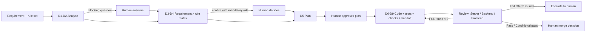

# Agent Develop & Agent Review

Two separate agents for AI-written Shopify app code:

- **Agent Develop** turns a requirement into `REQ-xx` items, checks them against a versioned rule set (BFS by default), **stops** to ask about gaps or rule conflicts, waits for plan approval, then writes code + tests on its own branch.
- **Agent Review** checks that branch **independently** — fresh context, original requirement, its own test runs in a separate worktree — and returns issues with evidence. The final verdict is computed **by code**, not by the model.

A human always makes the merge decision. There is no auto-merge, auto-deploy or App Store submission path.

> Status: **v0 — first working build.** Core logic is unit tested; the pipeline runs end to end in mock mode. The 30-PR benchmark has not been run yet, so no accuracy numbers are claimed.

## Flow



## How objectivity is enforced (by design, not by prompt)

| Risk | Control | Where |
|---|---|---|
| Reviewer influenced by the developer's reasoning | Each reviewer is a fresh call; gets only the original requirement, REQ ids, rules, diff, its own test runs | `src/agents/reviewAgent.ts` |
| "Pass" with no proof | Pass without verifiable evidence → `insufficient_evidence`; file:line is checked against the worktree | `src/core/verdict.ts` `normalizeItems` |
| Real-data rules (Web Vitals, installs) passed on code | Rules flagged `requiresRealData` can only pass with a measurement | `rules/*.json`, `normalizeItems` |
| Lenient final verdict | `computeVerdict` — fixed rules from the spec | `src/core/verdict.ts` |
| Fake issues to look thorough | Issues without verifiable evidence or repro steps are discarded (shown separately) | `filterIssues` |
| "Reviewer, please approve" comments | Repo content, handoff and diff are wrapped as `<untrusted_data>` | `src/llm/client.ts` |
| Develop agent weakens tests | Deterministic diff scan: removed assertions/cases, `.skip`, `.only`, deleted test files, trivial asserts | `src/core/testGuard.ts` |
| Handoff says tests pass but they fail | Reviewer re-runs checks in a clean worktree and raises a `false_claim` issue | `reviewAgent.ts` |

Verdict rules: **Fail** = any open blocker/high issue or a mandatory REQ failed. **Conditional pass** = otherwise, but medium issues or items without enough evidence remain. **Pass** = every mandatory REQ passes, only low issues left.

## Run it

```bash
nvm use 22
npm install
cp .env.example .env          # leave ANTHROPIC_API_KEY empty for mock mode
cp config/targets.example.json config/targets.json   # check commands + coder command
npm run dev                   # API :8787, UI :5173
npm test                      # unit tests for verdict, evidence, dedupe, test guard
```

Agent Develop delegates file edits to Claude Code in headless mode (`claude -p`, see `config/targets.json`) with an allow-list of tools and no push/merge. Shopify GraphQL must be verified through the Shopify Dev MCP (instructed in the coder prompt, D7).

## Rule sets

Rules are versioned JSON in `rules/` (`code`, `title`, `scopes`, `check`, `mandatory`, `requiresRealData`). Reviewer scopes are configured per rule set, so the finance rule set (project 3) uses *Server / Financial controls / Frontend* instead of the Shopify split.

## Benchmark (not run yet)

`npm run benchmark` reads `benchmark/cases/*/case.json` (repo, branch, seeded issues, `clean` flag), runs each review 3×, and writes detection rate, blocker detection, clean-PR false-fail rate and verdict consistency to `data/benchmark-result.json`. Targets: ≥80% detection, 100% blockers, ≤10% clean PRs failed, ≥90% consistency. Publish the real numbers, including misses.

## What is AI-written vs decided by me

- Architecture, verdict rules, evidence policy, test-guard heuristics: designed by me, code drafted with AI and reviewed.
- Prompts: v0, written with AI help; versions are logged with every call (`data/llm-calls.jsonl`).

## Known gaps (v0)

- Benchmark cases (20 seeded + 10 clean PRs) still to be built.
- No Playwright/screenshot capture in the review sandbox yet — frontend rules needing screenshots end as "not enough evidence".
- Runs are stored as JSON files, single user, no auth on the local UI.
